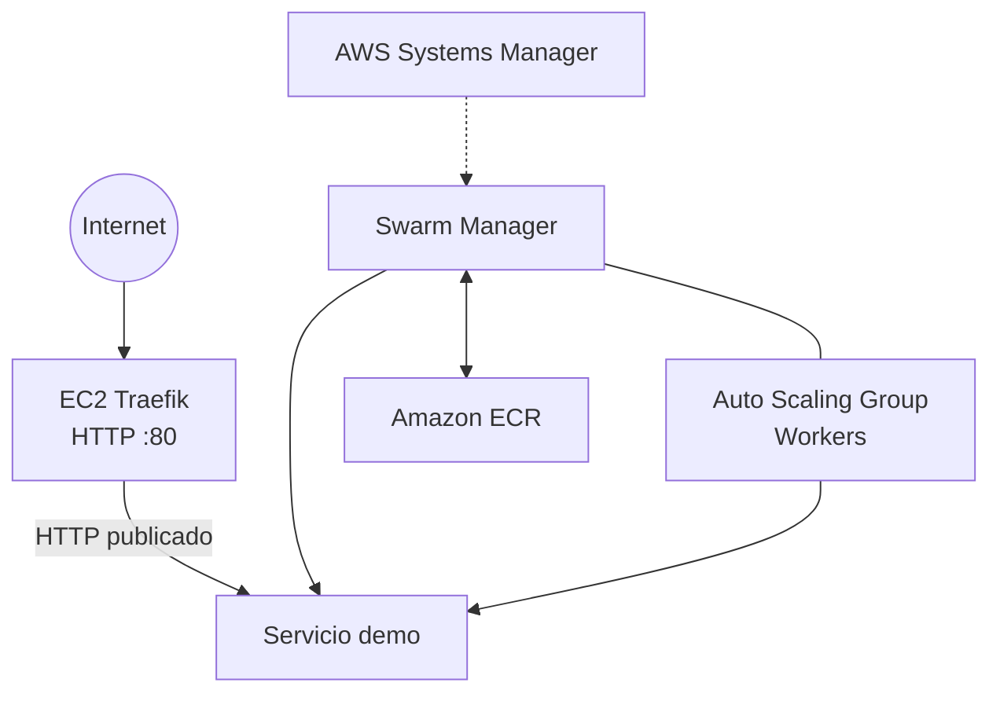

# Guía de despliegue

Procedimiento para preparar Terraform, revisar cambios y desplegar la app de
demostración en un Docker Swarm existente.

> Ejecuta estos pasos solo en una cuenta AWS propia/autorizada. Un `apply` puede
> crear, modificar o reemplazar recursos según el plan.

## Arquitectura



Terraform administra el manager y el grupo de workers. El manager es una
instancia separada: una capacidad deseada de un worker produce dos nodos
esperados (`manager + 1 worker`). Swarm puede conservar en `Down` nodos de
instancias reemplazadas; confirma el estado de EC2 antes de retirar una entrada.

## Requisitos

- Terraform y AWS CLI configurados con permisos para tu cuenta.
- Un instance profile con permisos requeridos por SSM y las operaciones de
  bootstrap del proyecto.
- `jq` y conectividad al servicio HTTP de la app.
- El provider Terraform y los scripts deben usar el perfil/identidad autorizado
  en tu equipo. Revisa sus valores por defecto antes de operar.

## Validar Terraform

Desde la raíz del repositorio:

```bash
terraform init
terraform fmt -check -recursive
terraform validate
terraform plan -out=tfplan
terraform show -no-color tfplan
```

Inspecciona todas las acciones del plan. No apliques un plan almacenado de otra
ejecución o creado antes de cambios de infraestructura.

```bash
terraform apply tfplan
```

Ejecuta `apply` solo después de confirmar el plan. Los cambios en `user_data`
pueden reemplazar EC2; comprueba especialmente las acciones `destroy` y
`replace`.

## Revisar nodos por SSM

Obtén el ID actual del manager desde Terraform y envía comandos por AWS Systems
Manager. Este ejemplo espera los resultados y los imprime:

```bash
AWS_PROFILE=${AWS_PROFILE:-default}
AWS_REGION=${AWS_REGION:-us-east-1}
MANAGER_ID=$(terraform output -raw swarm_manager_instance_id)

COMMAND_ID=$(aws ssm send-command \
  --profile "$AWS_PROFILE" --region "$AWS_REGION" \
  --document-name AWS-RunShellScript \
  --instance-ids "$MANAGER_ID" \
  --parameters '{"commands":["docker node ls","docker stack services demo"]}' \
  --query 'Command.CommandId' --output text)

aws ssm wait command-executed \
  --profile "$AWS_PROFILE" --region "$AWS_REGION" \
  --command-id "$COMMAND_ID" --instance-id "$MANAGER_ID"

aws ssm get-command-invocation \
  --profile "$AWS_PROFILE" --region "$AWS_REGION" \
  --command-id "$COMMAND_ID" --instance-id "$MANAGER_ID" \
  --query '{Status:Status,Output:StandardOutputContent,Error:StandardErrorContent}' \
  --output json
```

Confirma que el manager y los workers esperados estén `Ready`; el manager debe
ser `Leader`. No retires un nodo `Down` hasta comprobar que la instancia EC2
correspondiente está terminada y que el worker nuevo está unido.

## Desplegar la aplicación demo

El script empaqueta el código, construye/publica la imagen en ECR desde el
manager por SSM y despliega el stack. Revisa la configuración del perfil AWS
que utiliza el script antes de ejecutarlo.

```bash
./scripts/deploy-demo-app.sh <tag-de-imagen>

TRAEFIK_IP=$(terraform output -json instances_config | jq -r '.traefik.public_ip')
TRAEFIK_URL="http://${TRAEFIK_IP}"
curl -i "$TRAEFIK_URL/health"
```

La respuesta esperada es `HTTP 200`. La demo incluye `/health`, `/work`,
`/error` (500 intencional) y `/metrics`.

Para comprobar el servicio, usa el comando SSM de la sección anterior. El
script cierra la sesión ECR al terminar.

## Eliminar solo la app demo

Para retirar la aplicación desde el manager:

```bash
docker stack rm demo
```

Este comando elimina el stack `demo`; no elimina las instancias. Ejecútalo en
el manager o envíalo por SSM. No uses `terraform destroy` para quitar solo la
aplicación.

## Referencias

- [Índice de guías](./README.md)
- [Guía de k6](./GUIA-K6.md)
- [Guía de monitoreo](./GUIA-MONITOREO.md)
