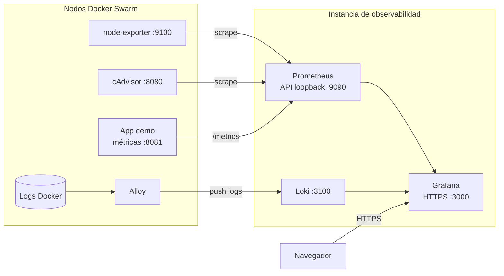

# Guía de monitoreo

Uso de Grafana para ver métricas y logs, validar targets y comprobar desde un
equipo local el flujo de telemetría.

## Flujo de datos



Prometheus y Loki son fuentes de datos internas de Grafana; no los expongas
directamente a Internet. La API de Prometheus de la configuración de referencia
escucha en loopback.

## Obtener los endpoints actuales

Desde la raíz del repositorio:

```bash
GRAFANA_URL=$(terraform output -raw observability_public_url)
TRAEFIK_IP=$(terraform output -json instances_config | jq -r '.traefik.public_ip')
TRAEFIK_URL="http://${TRAEFIK_IP}"
printf 'Grafana: %s\nApp: %s\n' "$GRAFANA_URL" "$TRAEFIK_URL"
```

Usa las direcciones actuales de tu despliegue; IPs de ejecuciones anteriores
pueden haber cambiado.

## Abrir Grafana

1. Abre la URL obtenida del output `observability_public_url`.
2. Usa `https://` y el puerto indicado por el output. No cambies el protocolo a
   HTTP: al hablar HTTP con un listener HTTPS se puede recibir
   `Client sent an HTTP request to an HTTPS server.`
3. Si el certificado es autofirmado, sigue la política de confianza de tu
   entorno antes de continuar.
4. Inicia sesión con credenciales autorizadas. No imprimas ni guardes secretos
   en documentación o logs.
5. Abre **Dashboards → Docker Swarm overview**, selecciona `Last 15 minutes` y
   actualiza tras generar tráfico.

Comprobación de API de Grafana, aceptando el certificado autofirmado solo en
esta petición de diagnóstico:

```bash
curl -ksS -o /dev/null -w 'Grafana API: HTTP %{http_code}\n' \
  "$GRAFANA_URL/api/health"
```

El resultado esperado es HTTP 200. Un endpoint de API protegido puede devolver
401 sin sesión, lo cual confirma que no está abierto anónimamente.

## Paneles y consultas

El dashboard de referencia contiene CPU y memoria por nodo, CPU por contenedor,
tasa de solicitudes de la app y logs Docker.

En **Explore → Prometheus**, consulta la disponibilidad:

```promql
up
```

Requests por endpoint y código:

```promql
sum by (endpoint, status) (demo_http_requests_total)
```

En **Explore → Loki**, consulta todos los logs Docker:

```logql
{job="docker"}
```

Eventos de solicitudes de la app:

```logql
{job="docker"} |= "http_request"
```

El scrape de referencia es cada 15 segundos; puede haber una demora antes de
que los datos aparezcan en un panel.

## Generar eventos de prueba

```bash
curl -i "$TRAEFIK_URL/health"
curl -i "$TRAEFIK_URL/work?delay_ms=50"
curl -i "$TRAEFIK_URL/error"
```

Se espera HTTP 200 para `/health` y `/work`; `/error` responde HTTP 500
intencionalmente para probar logs de error. Actualiza el dashboard y busca
`http_request` en Loki.

## Revisar nodos y targets por SSM

Prometheus y Docker Engine no están expuestos a Internet. Ejecuta estas
comprobaciones con AWS Systems Manager y una identidad autorizada:

```bash
AWS_PROFILE=${AWS_PROFILE:-default}
AWS_REGION=${AWS_REGION:-us-east-1}
OBS_ID=$(terraform output -raw observability_instance_id)

COMMAND_ID=$(aws ssm send-command \
  --profile "$AWS_PROFILE" --region "$AWS_REGION" \
  --document-name AWS-RunShellScript \
  --instance-ids "$OBS_ID" \
  --parameters '{"commands":["curl -fsS http://127.0.0.1:9090/api/v1/targets | jq -r \".data.activeTargets[]? | [.labels.job,.labels.role,.health] | @tsv\""]}' \
  --query 'Command.CommandId' --output text)

aws ssm wait command-executed \
  --profile "$AWS_PROFILE" --region "$AWS_REGION" \
  --command-id "$COMMAND_ID" --instance-id "$OBS_ID"

aws ssm get-command-invocation \
  --profile "$AWS_PROFILE" --region "$AWS_REGION" \
  --command-id "$COMMAND_ID" --instance-id "$OBS_ID" \
  --query '{Status:Status,Output:StandardOutputContent,Error:StandardErrorContent}' \
  --output json
```

Un estado `up` confirma que Prometheus recibe scrape del target, pero no
garantiza que todas las métricas estén disponibles. En el laboratorio de
referencia se observaron avisos de cAdvisor al identificar capas Docker; valida
que los paneles tengan series útiles, además de revisar el health del target.

## Lectura de resultados de referencia

En una ejecución de prueba se verificaron seis targets `up`: Prometheus,
`demo-app`, y node-exporter/cAdvisor en manager y worker. Loki devolvió los logs
JSON generados por las solicitudes. Estos valores son históricos y no
garantizan el estado actual:

```text
Grafana /api/health: HTTP 200
API protegida sin autenticación: HTTP 401
/health: HTTP 200
/work: HTTP 200
/error: HTTP 500 intencional
```

## Referencias

- [Índice de guías](./README.md)
- [Guía de despliegue](./GUIA-DESPLIEGUE.md)
- [Guía de k6](./GUIA-K6.md)
